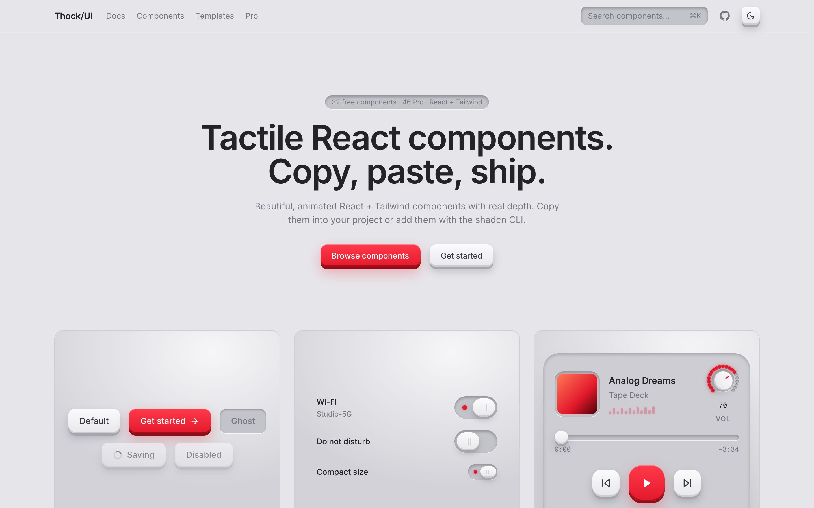
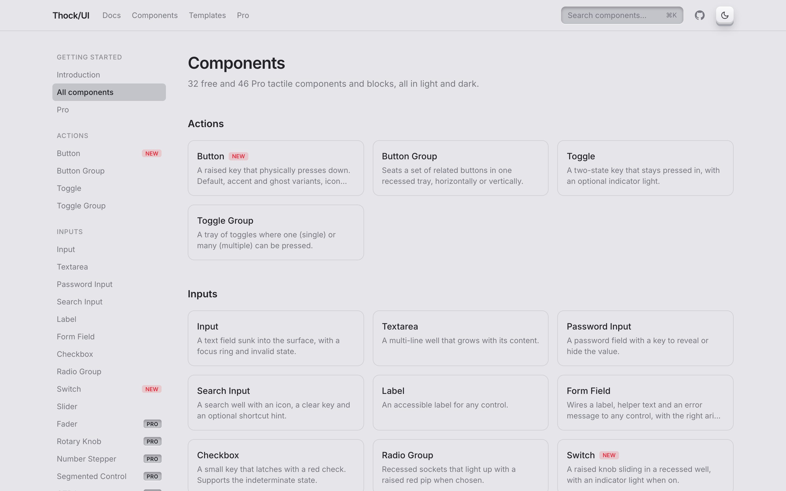

<div align="center">

# Thock UI

**Tactile React components you can almost feel.**<br>
Raised keys, recessed wells, LED accents and press states with real depth, in light and dark.

[](LICENSE)


[**Docs**](https://thock-ui.vercel.app/docs) · [**Components**](https://thock-ui.vercel.app/docs/components) · [**Templates**](https://thock-ui.vercel.app/templates) · [**Pro**](https://thock-ui.vercel.app/pro)

<a href="https://thock-ui.vercel.app">
  <picture>
    <source media="(prefers-color-scheme: dark)" srcset=".github/assets/home-dark.jpg">
    
  </picture>
</a>

</div>

## At a glance

| | |
| --- | --- |
| **What** | 30 components and 2 blocks with a hardware-inspired look, free and MIT-licensed |
| **Built on** | React 19, Tailwind CSS v4, Radix UI primitives (keyboard and screen-reader support built in) |
| **Install** | One command per component with the shadcn CLI, or copy and paste the source |
| **Theming** | One CSS file of design tokens drives every colour, shadow and press state in light and dark |
| **Yours** | Components are copied into your project as plain source. No runtime package, no lock-in |

## Quick start

You need a React app with Tailwind CSS v4 and a `components.json` (run `npx shadcn@latest init` if you don't have one).
Then add any component:

```bash
npx shadcn@latest add https://thock-ui.vercel.app/r/button.json
```

The CLI copies the component and anything it builds on, installs its npm packages and adds the tactile design tokens to
your global CSS. Use it like any other component:

```tsx
import { Button } from "@/components/ui/button";

export function Save() {
  return <Button variant="accent">Save changes</Button>;
}
```

Every component's page on the [docs site](https://thock-ui.vercel.app/docs/components) has a live preview, the source,
usage, props and keyboard support, with the exact install command. The full list is at
[`/r/registry.json`](https://thock-ui.vercel.app/r/registry.json).

<details>
<summary><b>Manual install (no CLI)</b></summary>

1. Copy [`src/registry/styles/tactile.css`](src/registry/styles/tactile.css) into your project and import it from your global CSS.
2. Copy [`src/registry/lib/utils.ts`](src/registry/lib/utils.ts) (the `cn()` helper) to `lib/utils.ts`.
3. Copy the component from [`src/registry/ui/`](src/registry/ui) to `components/ui/` and install the npm packages listed on its docs page.

</details>

## What's included

<a href="https://thock-ui.vercel.app/docs/components">
  <picture>
    <source media="(prefers-color-scheme: dark)" srcset=".github/assets/components-dark.jpg">
    
  </picture>
</a>

| Category | Free components |
| --- | --- |
| **Actions** | Button · Button Group · Toggle · Toggle Group |
| **Inputs** | Input · Textarea · Password Input · Search Input · Label · Form Field · Checkbox · Radio Group · Switch · Slider |
| **Overlays** | Dialog · Popover · Tooltip · Dropdown Menu · Select |
| **Navigation** | Tabs · Accordion |
| **Feedback** | Alert · Progress · Spinner · Skeleton · Badge |
| **Data display** | Avatar · Card · Kbd · Separator |
| **Blocks** | Checkout Card · Profile Card |

## Theming

All the depth comes from a few utilities over design tokens in [`tactile.css`](src/registry/styles/tactile.css):

| Utility | What it draws |
| --- | --- |
| `tactile-tray` | A panel the controls sit on |
| `tactile-well` | A recessed socket, for inputs and tracks |
| `tactile-key` | A raised key that presses down when active, pressed, checked or selected |
| `tactile-led` | An indicator light that turns on with `data-on` or inside a selected parent |

Change the accent or surface colours once in `:root` (light) and `.dark`, and every component follows. State is set
with attributes (`aria-pressed`, `data-state`, `data-selected`), so you never stack competing shadow classes.

## Free templates

Complete Next.js dashboards built with these components, free and MIT-licensed:

| Template | What it is | Code |
| --- | --- | --- |
| **Harbor Lite** | Personal finance: net worth, transactions, budgets | [thock-finance-lite](https://github.com/intellaralabs/thock-finance-lite) |
| **Maple House Lite** | Smart home: rooms, devices, scenes | [thock-smart-home-lite](https://github.com/intellaralabs/thock-smart-home-lite) |
| **Lowlight Studio Lite** | Music mixing: faders, meters, sessions | [thock-studio-lite](https://github.com/intellaralabs/thock-studio-lite) |
| **Oak Dial Lite** | SaaS analytics: KPIs, traffic, customers | [thock-analytics-lite](https://github.com/intellaralabs/thock-analytics-lite) |

## Free and Pro

| | Free (this repo) | [Thock UI Pro](https://thock-ui.vercel.app/pro) |
| --- | :---: | :---: |
| Components and blocks | 32 | 78 (all free + 46 Pro) |
| Knobs, faders, dock, gauges, sparklines, stat cards | | ✓ |
| Date, time and colour pickers, command menu, combobox, sheet, toast | | ✓ |
| Blocks: pricing, auth, settings, music player, smart home panel and more | | ✓ |
| Full dashboard templates (12–13 screens each) | Lite versions | ✓ (All-Access) |
| Licence | MIT | Pro licence |

## Run the docs site locally

```bash
npm install
npm run dev        # http://localhost:3000
```

Other scripts: `npm run build`, `npm start`, `npm run lint`. Set `NEXT_PUBLIC_SITE_URL` when you deploy, so the install
commands on the docs pages show your domain.

<details>
<summary><b>Project layout and adding a component</b></summary>

```
src/registry/
  styles/tactile.css   design tokens, tactile-* utilities and animations
  lib/utils.ts         cn()
  ui/                  components   → installs to components/ui/
  blocks/              blocks       → installs to components/blocks/
  examples/            demos rendered on the docs pages
  meta/<category>.ts   docs and registry metadata, one file per category
src/app/r/[name]/      serves the shadcn registry from the same files the docs use
```

To add a component:

1. Write `src/registry/ui/<slug>.tsx`. Import only from `@/components/ui/*`, `@/lib/utils` and npm packages.
2. Write a demo in `src/registry/examples/` (add `"use client"` if it holds state).
3. Add an entry to `src/registry/meta/<category>.ts` with its files, dependencies, usage, props and keyboard notes.

The sidebar, search, docs page and `/r/<slug>.json` pick it up automatically.

</details>

## Contributing

Bug reports and ideas are welcome in [Issues](https://github.com/intellaralabs/thock-ui/issues). For a pull request,
run `npm run lint` and `npm run build` first, and check the component in both light and dark.

## Licence

[MIT](LICENSE) © Intellara Labs. Made by [Intellara Labs](https://intellaralabs.com).
